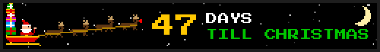
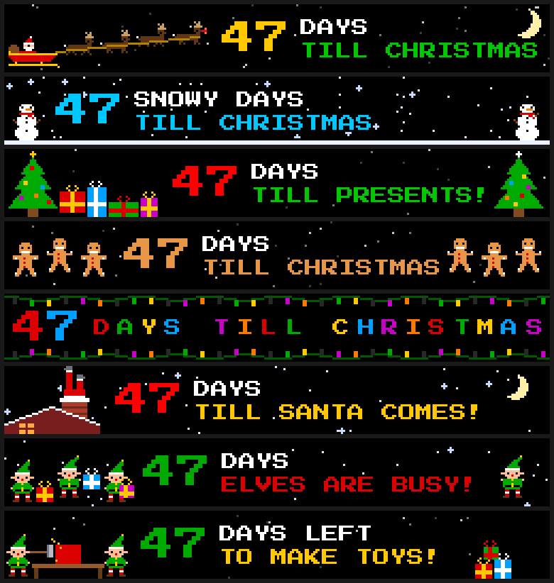

# Santa's Countdown

**Version 1.0.0** (2026-11-08) · by [BigC07](https://github.com/BigC07) · [Changelog](CHANGELOG.md)

An animated countdown to Christmas for [LEDMatrix](https://github.com/ChuckBuilds/LEDMatrix),
made for kids. Every time it comes round it shows a different scene, and every scene moves.

## The scenes

| Scene | What moves |
| --- | --- |
| `sleigh` | Santa and four reindeer fly by. The legs gallop, the team bobs, and Rudolph's bright red nose glows. |
| `snowman` | Snow falls and two snowmen wave. |
| `presents` | Two trees with blinking ornaments and twinkling stars, and the presents take turns bouncing. |
| `gingerbread` | Six gingerbread men dance, three on each side. |
| `lights` | Strings of bulbs chase along the top and bottom, the number flashes colours, and the words stretch the width of the card, every letter flashing. |
| `chimney` | Santa is stuck in the chimney with his legs in the air, kicking in turn, while snow falls and the window flickers. |
| `elves` | The elves hop and toss presents, and one throws a present in a high arc across the whole card to the elf on the other side -- a new present, in a new colour, every throw. |
| `workshop` | Elves build a present at their bench, one step at a time: one hammers the box together, the other ties on the ribbon and bow, it sparkles when it is done, and the next one starts. |

Each one shows the days left (`47 DAYS TILL CHRISTMAS`), `1 DAY` on Christmas Eve and
`MERRY CHRISTMAS!` on the day itself.

Every picture here was drawn by the plugin's own code at 256 × 32 LEDs, one pixel per LED.
There are no image files: all the art is in `santa_scenes.py`.

## Settings

| Setting | Default | |
| --- | --- | --- |
| `enabled` | `false` | Show it. |
| `display_duration` | `15` | Seconds on screen in normal rotation. |
| `scenes` | all eight | Which scenes to show. |
| `order` | `in_turn` | `in_turn` goes through them one after another; `random` picks a different one each time, never the one just shown. |
| `season_start` | `11-01` | Month-day to start showing. It stays up through Christmas Day and shows nothing the rest of the year, so it can stay enabled all year. |
| `animation_fps` | `6` | Animation steps per second in normal rotation. |
| `vegas_animation_hz` | `1` | Animation steps per second while it scrolls in Vegas mode. See below. |

## In Vegas mode

The card joins the scroll like any other plugin, and the scroll carries it the length of the
display, so the sleigh really flies across. It is a *live element* (LEDMatrix 3.8.0 and later):
the ticker redraws it in place while it is on screen, so the legs gallop and the snow falls as it
moves. On older versions it scrolls as a still picture.

The ticker caps how often it redraws a live element: **once a second** with the stock
`rgbmatrix` Python binding, faster with the rebuilt one (LEDMatrix's
`scripts/build_rgbmatrix_nogil.sh`). Keep `vegas_animation_hz` at that cap, so that every
redraw is a new step of the animation.

Each lap of the scroll gets the next scene, even when Santa's Countdown is the only thing in the
rotation.

## Panel sizes

Drawn for 32-row panels. On a 256-wide display everything fits. Narrower panels keep the main
character and shrink the words: `47 DAYS` at 128, `47` alone at 64. A 64-row panel gets the same
picture at double size.

## Install

By URL, in the web interface's plugin manager (install from URL):
`https://github.com/BigC07/ledmatrix-santa-countdown`. It is not in the Plugin Store yet. No API
keys, no network, no extra packages.

## License

GPL-3.0. All of the code and art is original to this plugin.
