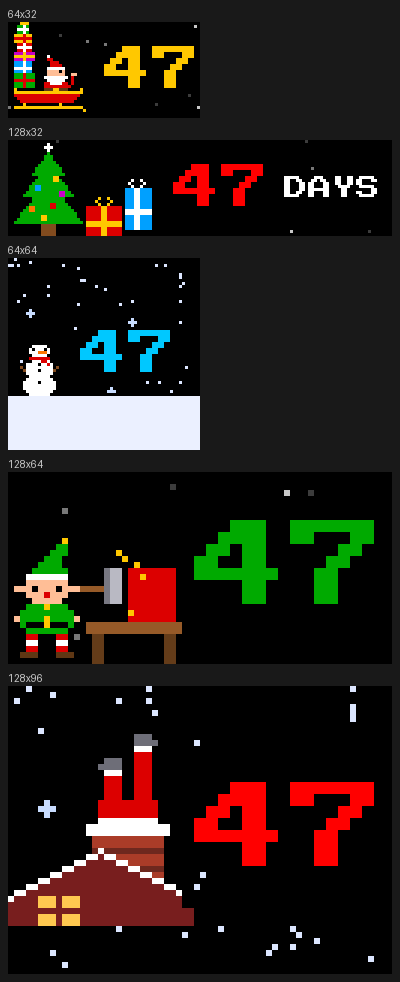

# Santa's Countdown

**Version 1.2.0** (2026-11-08) · by [BigC07](https://github.com/BigC07) · [Changelog](CHANGELOG.md)

An animated countdown to Christmas for [LEDMatrix](https://github.com/ChuckBuilds/LEDMatrix),
made for kids. Every time it comes round it shows a different scene, and every scene moves.

## The scenes

They take turns in this order, so no two elf scenes ever come one after the other.

| Scene | What moves |
| --- | --- |
| `sleigh` | Santa flies by with a teetering tower of presents in his sleigh and four reindeer. He waves, the tower wobbles, the legs gallop, the team bobs, and Rudolph's bright red nose glows. |
| `elves` | The elves hop and toss presents, and one throws a present in a high arc across the whole card to the elf on the other side -- a new present, in a new colour, every throw. |
| `snowman` | Snow falls and two big snowmen in top hats wave. |
| `loading` | Elves load Santa's parked sleigh: one lifts each present off the pile, the other hoists it over his head, and it lands on the growing tower in the back -- six presents, then the elves hop, the tower sparkles, and loading starts again. Two reindeer wait in harness. |
| `presents` | Two trees with blinking ornaments and twinkling stars, and the presents take turns bouncing. |
| `advent` | An advent calendar: 24 numbered doors in red and green. The days gone show their pictures -- a star, a candy cane, a bell, a stocking, all the way to a tree on the 24th -- and today's door has a blinking gold frame and swings open. All shut till December 1; narrower panels show the doors round today's. |
| `gingerbread` | Six gingerbread men dance, three on each side. |
| `clock` | The time, ticking every second, in red-and-white candy-cane stripes that roll along, centred over the date and the days to go. `time_format` picks 12h or 24h; the time zone is the core's. |
| `workshop` | Elves build a present at their bench, one step at a time: one hammers the box together, the other ties on the ribbon and bow, it sparkles when it is done, and the next one starts. |
| `nicelist` | Santa holds up his Nice List and writes in each name, ticks it, then checks it twice: every tick flashes again. The names come from `nice_list`, two to a scroll; with none it says `EVERYONE`. |
| `lights` | Strings of bulbs chase along the top and bottom, the number flashes colours, and the words stretch the width of the card, every letter flashing. |
| `tree` | Santa and an elf trim the tree: Santa walks along the bottom hanging ornaments, the elf on a ladder hangs the top ones and puts the star on top, then the ornaments flash, Santa waves and the elf cheers. |
| `tracker` | Santa's journey on Christmas Eve, worked out from the clock: he flies west with midnight across a world map, the places he has been lighting up with gold, and it says where he is and how long till he is here (`SANTA IS OVER ENGLAND`, `HERE IN 4:30:00`). Before then: `TAKE-OFF IN 46 DAYS`. Set `home_location` for a white dot at home, `home_name` to see your town's name when he gets there. The words alone at 128 columns, the map alone at 64. |
| `chimney` | Santa is stuck in the chimney with his legs in the air, kicking in turn, while snow falls and the window flickers. |

Each one shows the days left (`47 DAYS TILL CHRISTMAS`), `1 DAY` on Christmas Eve and
`MERRY CHRISTMAS!` on the day itself -- except the tracker, which counts down to Santa's take-off
and then follows him.

Every picture here was drawn by the plugin's own code at 256 × 32 LEDs, one pixel per LED.
The plugin loads no image files: all the art is code, in `santa_scenes.py`.

## Settings

| Setting | Default | |
| --- | --- | --- |
| `enabled` | `false` | Show it. |
| `display_duration` | `15` | Seconds on screen in normal rotation. |
| `scenes` | all fourteen | Which scenes to show. |
| `order` | `in_turn` | `in_turn` goes through them one after another; `random` picks a different one each time, never the one just shown. |
| `time_format` | `12h` | The clock scene's time: `12h` (4:32:15 PM) or `24h` (16:32:15). |
| `nice_list` | `[]` | Names on Santa's Nice List, up to 12 letters each. Empty: `EVERYONE`. |
| `home_name` | `""` | Your town, shown as the place Santa is over in the hour it is midnight at home. |
| `home_location` | `""` | `latitude, longitude` of home (e.g. `34.77, -84.97`): a blinking white dot on the tracker's map. The time zone is the core's. |
| `season_start` | `11-01` | Month-day to start showing. It stays up through Christmas Day and shows nothing the rest of the year, so it can stay enabled all year. |
| `animation_fps` | `6` | Animation steps per second in normal rotation. |
| `vegas_animation_hz` | `1` | Animation steps per second while it scrolls in Vegas mode. See below. |

## In Vegas mode

The card joins the scroll like any other plugin, and the scroll carries it the length of the
display, so the sleigh really flies across. It is a *live element* (LEDMatrix 3.8.0 and later):
the ticker redraws it in place while it is on screen, so the legs gallop and the snow falls as it
moves. On older versions it scrolls as a still picture.

The ticker caps how often it redraws a live element: **once a second** with the stock
`rgbmatrix` Python binding, faster with the rebuilt one (LEDMatrix's
`scripts/build_rgbmatrix_nogil.sh`). Keep `vegas_animation_hz` at that cap, so that every
redraw is a new step of the animation.

Each lap of the scroll gets the next scene, even when Santa's Countdown is the only thing in the
rotation.

## Panel sizes

Drawn for 32-row panels. On a 256-wide display everything fits. Narrower panels keep the main
character and shrink the words: `47 DAYS` at 128, `47` alone at 64. Taller panels get the picture
scaled up whole, as far as leaves at least 64 columns to draw in (128×64 doubles the 64-wide card;
64×64 shows the 64-wide card centred).

On a panel taller than the card, the rows above and below it carry on the scene's sky: falling
snow or twinkling stars.

## Install

By URL, in the web interface's plugin manager (install from URL):
`https://github.com/BigC07/ledmatrix-santa-countdown`. It is not in the Plugin Store yet. No API
keys, no network, no extra packages.

## Tested

On a Raspberry Pi 4 driving four 64×32 panels (256×32) in Vegas scroll mode, in the rotation
with sports, F1, a clock and weather cards, and on its own. LEDMatrix's safety harness
(`scripts/check_plugin.py`) passes at 64×32, 128×32, 64×64, 96×48, 128×64, 256×32, 128×96 and
256×128, and its Vegas live-element check passes too.

## License

GPL-3.0. All of the code and art is original to this plugin.
